# SPEC: Zelle Email Ingestion and Rent Reconciliation

**Status:** Approved for build (tracked in GitHub Issues #19-#25)
**Date:** 2026-11-25
**Owner:** Brian
**Companion PRD:** [zelle-ingestion-prd.md](./zelle-ingestion-prd.md)

---

## 1. Summary

Extend Keyturn's existing Resend inbound webhook and `payments` data seam to ingest forwarded Chase Zelle payment alert emails, parse and classify them deterministically (with a Claude Haiku fallback), auto-post unambiguous full rent payments into the existing `payments` ledger, and queue all exceptions (unknown payers, splits, partials, duplicates, deposits, parking, personal transfers) for fast landlord review.

---

## 2. Locked Decisions

| Area | Decision | Rationale |
| --- | --- | --- |
| **Scope split** | Zelle ingestion first; lease-renewal extensions deferred to a separate delta spec | DocuSeal renewals v1 is already built; separating the two keeps blast radius small and shippable. |
| **Target user (v1)** | Dogfood on Brian's landlord team first (full team RLS, no self-serve onboarding UI) | Avoids premature onboarding UX while preserving multi-tenant data isolation. |
| **Ingestion channel** | Resend Inbound forwarding to a private per-landlord `zelle+<token>@<domain>` address | Reuses Keyturn's Svix-verified Resend webhook, fits Resend Free tier (3,000/mo, 100/day shared), requires zero mailbox credentials, and avoids Google OAuth CASA verification / 7-day token expiry. |
| **Bank coverage (v1)** | Chase only | Single deterministic parser grounded in real fixtures beats fragile multi-bank guessing. |
| **Posting policy** | Auto-post high-confidence rent matches immediately (with 1-click Undo); queue all exceptions | Eliminates routine clicking for clean monthly rent while protecting the ledger from partial/duplicate/non-rent pollution. |
| **Payment patterns** | Support 1-to-1 rent, third-party aliases, 1-to-N housemate lump sums, grouped partials, and non-rent/personal triage | Matches real portfolio behavior; avoids forcing landlords back into spreadsheets for edge cases. |
| **Parking transfers (v1)** | Tag and acknowledge in the Zelle Inbox only; no `payments` write or parking ledger | `parking_leases` has no payments table yet and `parking_renters` have no `tenant_id`. Keeps v1 schema clean. |
| **Parsing & classification** | Deterministic Chase parser + keyword rules first; Claude Haiku (`@anthropic-ai/sdk`) fallback only on parse failure or ambiguous memo | Fast, free, unit-testable common path; reuses Keyturn's existing Anthropic SDK/key with zero new vendor or env var. |
| **Month attribution** | Explicit month in memo first; else day >= 20 -> next month, day < 20 -> current month (editable in queue) | Handles early late-month rent payments cleanly without requiring tenants to write a memo. |
| **Raw email retention** | Store extracted fields + raw email plain text and metadata in a new `zelle_events` Supabase table | ~2 KB per email; gives atomic writes, built-in team RLS, easy debugging, and re-parsing without Storage/Drive plumbing. |

---

## 3. Architecture and Dataflow

```mermaid
flowchart LR
    Chase["Chase Zelle Alert Email"] --> Inbox["Landlord Inbox Auto-Forward Filter"]
    Inbox --> Resend["Resend Inbound (zelle+token@domain)"]
    Resend -->|"POST email.received (metadata only, Svix signed)"| Webhook["/api/webhooks/resend"]
    Webhook -->|"GET /emails/receiving/{email_id}"| ResendAPI["Resend Received Emails API"]
    ResendAPI --> Parser["Deterministic Chase Parser + Keyword Rules"]
    Parser -->|"Parse fail or ambiguous memo"| Haiku["Claude Haiku Fallback (@anthropic-ai/sdk)"]
    Parser --> Matcher["Payer & Month Matcher (lib/zelle/)"]
    Haiku --> Matcher
    Matcher --> DB["Supabase: zelle_events"]
    Matcher -->|"All auto-post gates pass"| Payments["Supabase: payments (completed)"]
    DB --> UI["Landlord UI: Payments -> Zelle Inbox"]
    UI -->|"Confirm / Split / Link / Acknowledge / Ignore / Undo"| API["/api/zelle/* routes"]
    API --> Payments
    API --> Aliases["Supabase: zelle_payer_aliases"]
```

### Key Architectural Alignment With Keyturn

- **Reuses `/api/webhooks/resend`:** Inbound events addressed to `zelle+<token>@...` route into the Zelle handler before the existing `reply+<uuid>@...` tenant-reply branch. Outbound delivery/open/bounce events and tenant replies remain untouched.
- **New isomorphic entity seam (`lib/zelle/`):** Mirrors `lib/payments/` and `lib/maintenance/` with pure React-free modules (`parser.js`, `matcher.js`, `core.js`, `adapter.js`, `fake.js`, `mappers.js`, `status.js`, and unit tests wired into `package.json`).
- **Month-grid contract preserved:** Keyturn's Payments month grid ([property-management-app.jsx](file:///Users/brianmar/workspace/propmanager/property-management-app.jsx#L2765-L2826)) marks a month paid when a `payments` row has `status = 'completed'` for `(tenant_id, due_date YYYY-MM-01)`. Zelle rent postings write standard `completed` `recurring` rows and never touch `ach_status` (owned by Stripe). Non-rent (`deposit`, `other`) writes `type = 'one-time'` with a category tag so the month grid ignores them (requires updating the month grid filter to only check off rent payments, not one-time deposits).

---

## 4. External API Contracts (Verified 2026-11-25)

### 4.1 Resend Inbound (`email.received`)

- **Free tier limits:** Up to 3,000 emails/month and 100 emails/day (shared pool with outbound), up to 3 inbound inboxes. Hard cap (no pay-as-you-go overages).
- **Signature verification:** Svix HMAC-SHA256 via `svix-id`, `svix-timestamp`, and `svix-signature` headers, already implemented in [app/api/webhooks/resend/route.js](file:///Users/brianmar/workspace/propmanager/app/api/webhooks/resend/route.js).
- **Metadata-only webhook payload:** Resend's `email.received` webhook does **not** carry `html`, `text`, or full headers. It sends `data.email_id`, `data.from`, `data.to`, `data.subject`, `data.message_id`, and `data.attachments`.
- **Follow-up fetch required:** The webhook handler must call `resend.emails.receiving.get(emailId)` (`GET /emails/receiving/{email_id}` using existing `RESEND_API_KEY` and `resend` v6.9.3) to retrieve `text`, `html`, and `headers`.
- **Security boundary for forwarded mail:** Auto-forwarding from Gmail/Outlook changes the SMTP envelope sender to the landlord's email provider, so original Chase SPF/DKIM alignment is not guaranteed. Trust is enforced by three layers:
  1. Svix webhook signature verification.
  2. Unguessable high-entropy per-landlord inbound token (`zelle+<token>@<domain>`), stored per team in `landlord_profiles` (or a dedicated token column) and rotated on demand.
  3. Content validation confirming the email is a Chase Zelle received-payment alert (not a Chase sent-payment alert or unrelated forwarded email); unrecognized mail is saved as `parse_failed` / `ignored` and never auto-posted.

### 4.2 Claude Haiku Fallback (`@anthropic-ai/sdk`)

- Invoked **only** when deterministic Chase parsing fails to extract required fields (`payerName`, `amount`, `receivedAt`) OR when a non-empty memo does not match deterministic category rules.
- Prompt treats the email text as untrusted input and requests strict JSON output (`payer_name`, `amount`, `memo`, `category`, `target_month`, `direction` received vs sent, `confidence`).
- **Hard invariant:** An event whose extraction or category relied on the LLM fallback is **never auto-posted** in v1; it always lands in `needs_review` so the landlord verifies before ledger writes. (Re-evaluated only after collecting real fallback traces.)

---

## 5. Conceptual Data Model (DDL at Build Time)

All new tables live in Supabase with `landlord_id` and RLS policy `public.is_team_member(landlord_id)` (matching `lease_renewals` and `email_messages`). Service-role webhook writes bypass RLS after validating the inbound token to resolve `landlord_id`.

### 5.1 `landlord_profiles` (small extension)

- `zelle_inbound_token` (unique text, nullable until enabled) - maps `zelle+<token>@<domain>` to `landlord_id`.

### 5.2 `zelle_events` (new table)

First-class audit record and review queue item for every inbound email routed to a landlord's Zelle address.

- **Identity & dedup:** `id`, `landlord_id`, `resend_email_id` (unique), `dedupe_key` (unique per `landlord_id`: Chase transaction/confirmation ID when present, else normalized email `message_id`).
- **Raw evidence:** `email_from`, `email_subject`, `received_at`, `raw_body` (plain text, fallback stripped HTML), `raw_headers` (`jsonb`).
- **Extracted fields:** `bank` (`'chase'`), `direction` (`'received' | 'sent' | 'unknown'`), `payer_name`, `amount`, `memo`, `zelle_txn_id`, `parse_source` (`'rules' | 'llm' | 'failed'`), `parse_notes`.
- **Classification & suggestion:** `category` (`'rent' | 'deposit' | 'parking' | 'other' | 'ignore'`), `target_month` (`YYYY-MM-01`), `suggested_tenant_ids` (`jsonb` array), `suggested_contract_id`, `match_reason`.
- **Workflow state:** `status` (`'auto_posted' | 'needs_review' | 'confirmed' | 'linked' | 'acknowledged' | 'ignored'`), `posted_payment_ids` (`jsonb` array of created/linked `payments.id` values), `resolved_at`, `resolved_by` (`auth.uid()`), `created_at`, `updated_at`.

### 5.3 `zelle_payer_aliases` (new table)

Maps recurring non-exact Zelle sender names (parents, guarantors, spouses, alternate legal names, or a housemate who pays a shared contract lump sum) to a tenant or contract.

- `id`, `landlord_id`, `payer_name_normalized` (lowercased, collapsed whitespace, stripped punctuation), `payer_name_display`.
- Target: `tenant_id` (nullable) OR `contract_id` (nullable), with a check ensuring exactly one target is set.
- Unique per `(landlord_id, payer_name_normalized)` so one alias never ambiguously points to two targets.
- Note: Existing `tenant_profiles.zelle_name` is also checked directly by the matcher without requiring migration, so existing landlord data works on day one.

### 5.4 `payments` (minimal extension)

- Add optional `payment_method` (nullable text, e.g., `'stripe_ach' | 'zelle' | 'manual'`) and `category` (nullable text, defaulting to `'rent'` for existing rows so backwards compatibility is preserved) and `zelle_event_id` (nullable FK to `zelle_events.id` with `ON DELETE SET NULL`).
- **Invariant:** Month-grid paid lookup filters to `status === 'completed'` and `category !== 'deposit' && category !== 'other'` (i.e., rent rows only), ensuring a logged one-time deposit never checks off a tenant's monthly rent checkbox.

---

## 6. Deterministic Parser, Matcher, and Safety Rules

### 6.1 Chase Parser (`lib/zelle/parser.js`)

Grounded against a real Chase Zelle alert `.eml` inspected on 2026-11-25 (sanitized structure):

- **HTML-only email:** Chase sends `Content-Type: text/html; charset=UTF-8` (`quoted-printable`) with **no `text/plain` part**. The parser must accept `html` directly (preferring `html` over `text` when `html` is present, stripping `<head>`, `<style>`, and `<script>` blocks, or reading the details table directly) and also tolerate Gmail forwarding wrapper headers/blocks when `text` is used.
- **Signal & direction verification:**
  - `From` (or forwarded `From:`): `no.reply.alerts@chase.com`
  - `Subject`: `You received money with Zelle®` (allowing optional `Fwd:` prefix and `®` or stripped trademark symbol)
  - `<title>` hint when intact: `zelle_auto_accept_receiver`
  - Headline: `<PAYER_NAME> sent you money` (payer name arrives in uppercase, e.g., `JANE DOE sent you money`, normalized for matching)
  - Any email lacking the received-money headline/subject (for example, outgoing sent-money alerts) is marked `direction = 'sent'` or `'unknown'` and never auto-posted.
- **Details table fields:** Chase renders a two-column key/value table (`<td>Label</td><td><b>Value</b></td>`):
  - `Amount` - currency string (e.g., `$1,250.00`), parsed to positive numeric dollars.
  - `Sent on` - date string (`Mon DD, YYYY`, e.g., `Nov 16, 2026`), parsed to `YYYY-MM-DD` and used as the canonical transaction date (independent of forwarding delay).
  - `Transaction number` - numeric confirmation ID (e.g., `12345678901`), used as `zelle_txn_id` and primary `dedupe_key`.
  - `Memo` - optional free text (e.g., `Apt 303 Nov`); omit gracefully if Chase leaves the row out when the sender wrote no memo.
- **Stored raw evidence:** Save a clean stripped plain-text rendering of the email body in `zelle_events.raw_body` (dropping Chase's ~20 KB of CSS/script/layout boilerplate so the audit view is readable and compact).

### 6.2 Category Rules (`lib/zelle/classifier.js`)

- Empty memo -> defaults to `rent` (most tenants leave Zelle memos blank or write only the unit/month).
- Keyword rules (case-insensitive, word-boundary matched):
  - `parking`, `spot`, `garage`, `car` -> `parking`
  - `deposit`, `security` -> `deposit`
  - `utility`, `utilities`, `electric`, `water`, `gas`, `internet`, `wifi`, `trash` -> `other`
  - `rent`, unit references (`apt`, `unit`, `#`), or full/abbreviated month names (`jan`..`dec`) -> `rent`
- Unrecognized non-empty memo -> calls Claude Haiku fallback and forces `needs_review`.
- **Unit-hint bonus for Review Queue:** When a payer is unknown on first sighting but the memo contains a unit token (e.g., `Apt 303`), highlight the tenant(s) in that unit at the top of the suggested-tenant picker (still never auto-posts without a known payer match).

### 6.3 Target Month Attribution

1. If memo explicitly names a month (e.g., "June", "Jun rent", "06/2026"), resolve to the nearest matching calendar month relative to `receivedAt` (handling Dec/Jan year rollover cleanly).
2. Otherwise, apply cutoff rule on `receivedAt` in the landlord's local/US calendar date: `day >= 20` -> first of next month; `day < 20` -> first of current month.

### 6.4 Payer Resolution and Auto-Post Gates

Active candidate pool: tenants in `landlord_id` whose property passes `nonProductionPropertyIds(properties)` (production properties only) and whose derived status (`lib/tenant/status.js` `isCurrentRow`) is current.

Priority order for payer lookup (normalized name):
1. Exact match on `zelle_payer_aliases` (`tenant_id` or `contract_id`).
2. Exact match on `tenant_profiles.zelle_name`.
3. Exact match on full tenant name (`name + last_name`).

**Auto-post fires ONLY when ALL six gates pass:**
1. `parse_source === 'rules'` and `direction === 'received'` and `amount > 0`.
2. `category === 'rent'`.
3. Payer resolves unambiguously to exactly one active production-property tenant (or one explicitly aliased `contract_id`).
4. Amount equals expected rent:
   - Single tenant: `amount === tenant.monthlyRent` (exact, non-zero).
   - Contract alias: `amount === sum(active contract tenants' monthlyRent)` (exact, non-zero).
5. None of the target `(tenant_id, target_month)` pairs already has a `completed` rent row in `payments`.
6. No duplicate `dedupe_key` exists in `zelle_events`.

If **any** gate fails, the event is stored as `needs_review` with a clear `match_reason` badge (e.g., `unknown_payer`, `amount_mismatch`, `partial_payment`, `already_paid`, `non_rent_category`, `llm_fallback`, `parse_failed`).

### 6.5 Partial Payments and Housemate Splits

- **Partial accumulation helper:** In the review queue, when multiple `needs_review` rent events exist for the same `(tenant_id, target_month)`, the UI shows their running sum vs expected rent (e.g., `$1,000 + $800 = $1,800 / $1,800`) and allows a single **Confirm Group** action that posts the reconciled payment(s) and marks all grouped events `confirmed`.
- **Housemate 1-to-N split:** When a landlord selects a shared contract in review, Keyturn pre-fills the split amounts from each tenant's `monthlyRent` (editable) and, on Confirm, inserts one `completed` `payments` row per tenant referencing the same `zelle_event_id`.
- **Undo on `auto_posted`:** Deletes the payment row(s) in `posted_payment_ids` (only if still linked to this `zelle_event_id`), clears `posted_payment_ids`, and transitions `zelle_events.status` from `auto_posted` to `needs_review`.

---

## 7. UI Surface and Integration Points

- **Location:** Add a **Zelle Inbox** tab inside the existing `/payments` page (alongside the Month Grid and Payment History), plus a compact pending-review badge count. Keeping it under `/payments` avoids a new top-level sidebar route and `APP_PREFIXES` entry while keeping reconciliation right next to the month grid.
- **Tabs inside Zelle Inbox:** `Needs Review` (default), `Auto-Posted` (with 1-click Undo), and `History` (`confirmed`, `linked`, `acknowledged`, `ignored`).
- **Dashboard load & store:** Load `zelleEvents` and `zellePayerAliases` in `lib/dashboard/load.js` (RLS-protected anon client) and expose mutations through `useZelleMutations()` following Keyturn's seamed entity pattern.
- **Translations:** Add all landlord-visible labels, statuses, match-reason badges, modal strings, and toasts to both `T.en` and `T.zh` in `lib/i18n/strings.js`.

---

## 8. Phased Implementation Plan

### Phase 1: Schema, Entity Seam, and Chase Parser (Offline / Unit-Tested)
- Add Supabase migration for `landlord_profiles.zelle_inbound_token`, `zelle_events`, `zelle_payer_aliases`, and minimal `payments` columns (`payment_method`, `category`, `zelle_event_id`) with RLS policies.
- Build `lib/zelle/` (`parser.js`, `classifier.js`, `matcher.js`, `mappers.js`, `status.js`, `core.js`, `adapter.js`, `fake.js`) and wire `lib/zelle/*.test.mjs` into `package.json`.
- Lock Chase parser unit tests against 1-2 sanitized real Chase emails plus edge cases (forwarded headers, blank memo, month-name memo, Dec/Jan rollover, sent vs received alert, partial amount, duplicate transaction ID).

### Phase 2: Resend Inbound Ingestion and Auto-Post Pipeline
- Extend `app/api/webhooks/resend/route.js` to detect `zelle+<token>@...` recipients, resolve `landlord_id`, fetch full email via `resend.emails.receiving.get(emailId)`, run parser + optional Claude Haiku fallback, run matcher, enforce idempotent dedup, and either auto-post or enqueue as `needs_review`.
- Add dry-run / webhook integration tests using mocked Resend payloads (never send live emails in tests).

### Phase 3: Reconciliation APIs and Zelle Inbox UI
- Add authenticated landlord API routes for Confirm (1-to-1, 1-to-N split, grouped partials, deposit/other), Link to Existing Payment, Acknowledge (parking), Ignore, Undo Auto-Post, and Payer Alias management (all enforcing `requireLandlord()` and `rejectMismatchedLandlord()`).
- Build the Zelle Inbox UI inside `/payments` with bilingual `T.en`/`T.zh` strings and update the month-grid filter so `one-time` non-rent rows do not check off monthly rent.

### Phase 4: Dogfood Rollout and Observability
- Generate inbound token for Brian's landlord team, verify Resend Inbound MX records, and set up the Gmail/Outlook Chase auto-forward rule.
- Monitor the first month of real Chase emails in `zelle_events` (inspect parse failures, fallback triggers, and match accuracy). Collect real traces before designing any LLM evals.

---

## 9. Verification Plan

- **Unit tests (`npm test`):** Pure tests for Chase parsing (sanitized real fixtures), month cutoff/rollover, category rules, payer matching priority, all 6 auto-post safety gates, dedup idempotency, split/partial math, and Undo rollback via `lib/zelle/fake.js`.
- **Lint & build:** `npm run lint` and `npm run build` (covers new API routes and client/server boundaries).
- **End-to-end staging check:** Replay a signed test `email.received` webhook payload locally against mocked Resend fetch to verify auto-post, duplicate suppression, review queue actions, and Undo in the browser (both English and Chinese UI).
- **LLM fallback evals (deferred until real traces exist):** Do not build synthetic evals or judges up front. If Claude Haiku fallback triggers in production, collect >= 20 real fallback traces first and review them together before building any eval.

---

## 10. Prerequisites and Risks

### External Prerequisites (Manual)
1. **Sanitized Chase Zelle alert email** - **Done (2026-11-25).** Structure verified (`text/html` only, headline + 4-row details table). One optional second sample without a memo (if Chase omits the `Memo` row) is nice-to-have, not blocking.
2. **Resend Inbound MX records** verified on the Keyturn domain and `email.received` event enabled on the existing Resend webhook pointing to `/api/webhooks/resend` (needed before Phase 4 live testing).
3. **Gmail auto-forward filter** configured with `from:(no.reply.alerts@chase.com) subject:("You received money with Zelle")` forwarding to `zelle+<token>@<domain>` (needed for Phase 4 dogfooding).

### Risks and Mitigations
- **Chase changes email wording or HTML structure:** Mitigated by storing `raw_body` on `zelle_events`, falling back to Claude Haiku + `needs_review` (never silent drop, never unsafe auto-post), and re-parsing from saved rows after fixing the regex.
- **Forwarding filter catches outgoing Zelle alerts or non-Zelle Chase emails:** Mitigated by checking `direction` (received vs sent) and requiring positive received-payment patterns; non-matching emails never auto-post.
- **Resend Free tier 100/day cap during a bulk rent-reminder day:** Outbound reminders and inbound Zelle alerts share the 100/day pool. At ~25 units this leaves plenty of headroom, but if automated reminders ever spike near 100/day on the 1st of the month, Resend would block inbound emails until UTC midnight. Mitigation: keep reminder batches staggered or monitor Resend daily usage.
- **Double-posting when landlord manually checks off a month before/after Zelle arrives:** Mitigated by auto-post Gate 5 (`already_paid` check) plus the one-click **Link to Existing Payment** action in the review queue.
